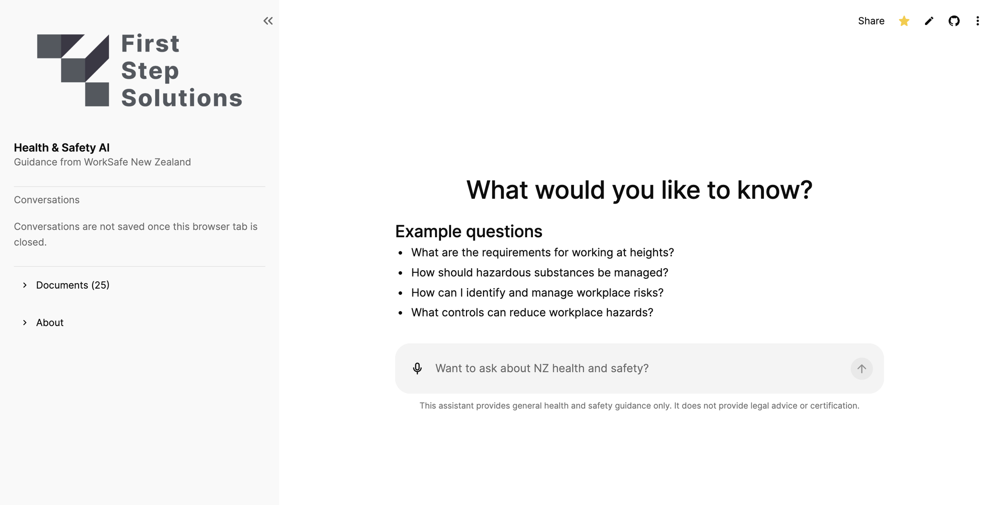
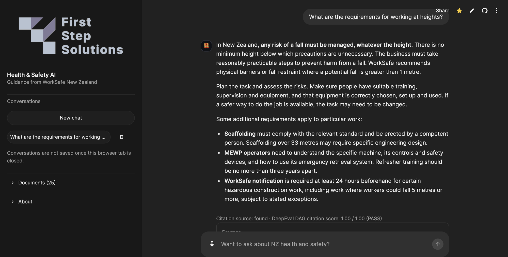

# Health & Safety AI

A chatbot that helps New Zealand small businesses understand their workplace health and safety obligations. Ask a question in plain language, by text or voice, and get a clear answer grounded in WorkSafe NZ guidance and the Health and Safety at Work Act 2015, with citations to the exact document and page.

**Live demo:** [first-step-ai.streamlit.app](https://first-step-ai.streamlit.app)

<p align="center">
  
  
</p>

---

## Running locally

**Requirements:** Python 3.14 and an OpenAI API key.

```bash
# 1. Clone and enter the repo
git clone https://github.com/RupertGuppy03/Health-Saftey-AI.git
cd Health-Saftey-AI

# 2. Create a virtual environment and install dependencies
python3 -m venv .venv
source .venv/bin/activate          # Windows: .venv\Scripts\activate
pip install -r requirements.txt

# 3. Add your API key
cp .env.example .env               # then set OPENAI_API_KEY in .env

# 4. Unpack the pre-built vector store
tar -xzf vectorstore-snapshot.tar.gz -C vectorstore
```

Then start the backend and the interface in two terminals:

```bash
./scripts/run_api.sh               # backend  → http://localhost:8000
./scripts/run_ui.sh                # frontend → http://localhost:8501
```

Open **http://localhost:8501** once the backend logs `Ready`.

To run the tests:

```bash
python3 -m pytest
```

---

## Repository layout

```
Health-Safety-AI/
├── src/
│   ├── api/            FastAPI backend
│   ├── ui/             Streamlit chat interface
│   ├── retrieval/      Finds the relevant guidance for a question
│   ├── ingestion/      PDF extraction and cleaning
│   ├── embeddings/     Chunking and embedding the corpus
│   ├── evaluation/     Citation and edge-case evaluation
│   └── config/         Settings and prompts
├── data/raw/           Source PDFs from WorkSafe NZ
├── tests/              Unit tests and AI evaluations
├── notebooks/          Sprint experiments and evaluation runs
├── scripts/            One-command runners for the API, UI and checks
├── docs/               Deployment guide, test results and timings
├── references/         User stories and sprint planning
├── streamlit_app.py    Frontend entry point
└── Dockerfile          Backend container image
```

---

## Model and tech stack

| | |
|---|---|
| **Answering model** | OpenAI `gpt-6-luna` |
| **Embeddings** | OpenAI `text-embedding-3-small` |
| **Voice transcription** | OpenAI `gpt-4o-transcribe` |
| **Orchestration** | LangChain |
| **Vector store** | ChromaDB |
| **Backend** | FastAPI, containerised with Docker |
| **Frontend** | Streamlit |
| **Evaluation** | pytest and DeepEval |
| **Hosting** | Azure Container Apps (backend), Streamlit Community Cloud (frontend) |

See [`docs/deployment.md`](docs/deployment.md) for deployment details.

---

## About

**How it works.** The assistant is a Retrieval-Augmented Generation (RAG) system. 25 WorkSafe NZ PDFs were extracted with Unstructured, cleaned, split into ~750-token chunks and embedded into ChromaDB. When a question comes in, it is checked against a scope guardrail, embedded, and matched to the six closest chunks. The model answers only from those chunks and cites each source's document and page. DeepEval then scores every answer for citation accuracy.

Follow-up questions are rewritten so they make sense on their own before retrieval. Conversation history stays in the browser tab and is never stored on the server. Voice questions are transcribed into the chat box for the user to check before sending.

**Adding documents.**

1. Put the PDF in `data/raw/building_and_construction/<doc>/`.
2. Extract it with `python -m src.ingestion.extract`, then clean it with `python -m src.ingestion.clean`.
3. Chunk it with `notebooks/S2_pipeline.ipynb`.
4. Embed it with `python -m src.ingestion.backfill_vectorstore`.

Re-running ingestion is safe because chunk IDs are deterministic. Extraction and embedding are paid API calls. Embedding the whole corpus costs a few cents.